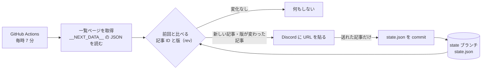

# LoL Patch Notes Watch

[](https://github.com/a-a81/lol-patch-notes-watch/actions/workflows/watch.yml)
[](https://github.com/a-a81/lol-patch-notes-watch/actions/workflows/test.yml)

League of Legends の[日本語パッチノート一覧](https://www.leagueoflegends.com/ja-jp/news/tags/patch-notes/)を 1 時間ごとに確認し、新しい記事や更新された記事があれば、その URL を Discord に貼ります。何も変わっていなければ何もしません。

- GitHub Actions だけで動きます。サーバーや自宅 PC は要りません。
- 前回の状態は JSON にして、このリポジトリの [`state` ブランチ](../../tree/state)に保存します。commit の履歴が、そのままパッチノートの更新の記録になります。
- 実行時は Python の標準ライブラリだけを使います。

詳しい仕様は [SPEC.md](SPEC.md) にあります。

## 仕組み



| 前回の状態 | 一覧の版 | 処理 |
|---|---|---|
| ない | - | 新しい記事として URL を貼る |
| ある | 違う | 更新された記事として URL を貼る |
| ある | 同じ | 何もしない |

## 工夫したところ

- **HTML ではなく埋め込みの JSON を読む**: ページは Next.js 製で、記事の一覧が `<script id="__NEXT_DATA__">` に入っています。見た目の HTML を解析しないので、デザインが変わっても壊れにくいです。
- **更新は版（`rev`）で判定する**: 文字数で比べると、パッチノートでよくある「30 → 35」のような同じ長さの書き換えを見逃します。版は記事が編集されると変わるうえ、一覧ページ 1 回で全記事分が分かります。
- **取りこぼさず、二重にも送らない**: Discord が受け付けた（`?wait=true`）記事だけ、その場で状態に記録します。送れなかった記事とそれ以降は次の回に送り直すので、並び順も崩れません。ワークフローは送信に失敗した回でも、送れた分の状態を commit します。
- **大量に送らない**: 初回は記録するだけです。1 回で 6 件以上変化したら、URL を貼らずに失敗扱いにします。記事 ID の形が変わったとき、全記事が「新しい記事」に見えて大量に貼るのを防ぐためです。
- **毎回 commit しない**: 状態には「最後に確認した時刻」のような毎回変わる値を持たせていません。何かが変わった回だけ commit されます。
- **秘密情報を出さない**: Webhook の URL は GitHub の Secrets に置き、エラーメッセージやログにも出しません。`allowed_mentions` を空にして、誤ってメンションしないようにしています。
- **ネットにつながずにテストできる**: 判定の処理は送信と保存を引数で受け取るので、テストでは偽物を渡せます。

## セットアップ

1. このリポジトリを fork するか、自分のリポジトリに置く。
2. Discord のチャンネル設定 → 連携サービス → ウェブフック で Webhook を作り、URL をコピーする。
3. リポジトリの Settings → Secrets and variables → Actions → New repository secret で、`DISCORD_WEBHOOK_URL` という名前で URL を登録する。
4. Actions タブ → Watch patch notes → Run workflow で、`send_latest` にチェックを入れて実行する。最新のパッチノートの URL が Discord に届けば設定は完了。
5. もう一度、チェックを外して実行する。初回なので、全記事を通知せずに記録し、`state` ブランチができる。以降は毎時自動で動く。

失敗した回（一覧ページの形が変わった、Discord に送れなかったなど）は Actions の実行が失敗になり、GitHub からメールが届きます。

## 手元で動かす

```bash
python -m patchwatch --dry-run                 # 送らずに、貼る URL をログに出す（状態も保存しない）

export DISCORD_WEBHOOK_URL="https://discord.com/api/webhooks/..."
python -m patchwatch --send-latest             # 最新の記事の URL を 1 件送る
python -m patchwatch --state state/state.json  # Actions と同じ処理
```

| オプション | 既定 | 内容 |
|---|---|---|
| `--state` | `state/state.json` | 状態ファイルの場所 |
| `--max-changes` | 5 | 1 回に貼る URL の上限 |
| `--dry-run` | - | 送らずに貼る URL をログに出す。状態も保存しない |
| `--send-latest` | - | 最新の記事の URL を 1 件送って終わる |
| `--commit-message-file` | - | `state` ブランチの commit メッセージを書き出すファイル |

## テスト

```bash
pip install pytest
python -m pytest
```

## 構成

```
patchwatch/
  __main__.py   コマンドの入口（引数・ログ・Actions の Summary・commit メッセージ）
  riot.py       一覧ページの取得と解析
  watcher.py    前回と比べて、貼る記事と記録する記事を決める
  discord.py    Discord の Webhook に送る
  state.py      state.json の読み書き
tests/          pytest（ネットにつながずに動く）
.github/workflows/
  watch.yml     毎時の見張り
  test.yml      push と Pull Request でテスト
```

## 注意

LoL Patch Notes Watch isn't endorsed by Riot Games and doesn't reflect the views or opinions of Riot Games or anyone officially involved in producing or managing Riot Games properties. Riot Games, and all associated properties are trademarks or registered trademarks of Riot Games, Inc.

一覧ページへのアクセスは 1 時間に 1 回だけで、User-Agent でこのリポジトリを名乗っています。
